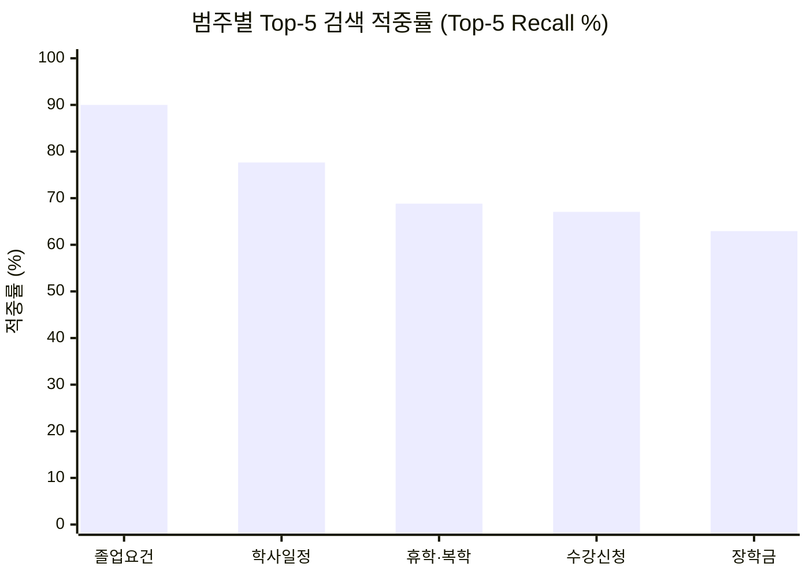

# CampusRAG 1,000문항 전수 평가 및 통계 분석 보고서

**평가 기준일자**: 2026-11-09  
**평가 대상 문항**: 1,000문항 (`campusrag_eval_dataset.json`)  
**평가 파이프라인**: 100% 로컬 환경 (외부 Gemini API 미사용)  
- **임베딩 모델**: `jhgan/ko-sroberta-multitask`  
- **로컬 LLM**: `Qwen/Qwen2.5-1.5B-Instruct`  
- **벡터 인덱스**: 로컬 ChromaDB (`campus_knowledge`, 7,731 chunks, 1,602 docs)  
- **평가 모드**: Top-5 Vector Retrieval & LLM Pipeline Inference  

---

## 1. 종합 평가 결과 요약 (Executive Summary)

```
┌───────────────────────────────────────┬────────────┬────────────┬─────────────┐
│ 평가 지표 (Metric)                    │ 대상 수량  │ 적중 건수  │ 정확도 / 성공률│
├───────────────────────────────────────┼────────────┼────────────┼─────────────┤
│ 단일 원문 (Single) Top-1 정확도       │ 700문항    │ 575건      │ 82.14%      │
│ 단일 원문 (Single) Top-3 정확도       │ 700문항    │ 582건      │ 83.14%      │
│ 단일 원문 (Single) Top-5 정확도       │ 700문항    │ 599건      │ 85.57%      │
├───────────────────────────────────────┼────────────┼────────────┼─────────────┤
│ 복수 원문 (Multi) Top-5 전원 적중     │ 150문항    │ 24건       │ 16.00%      │
│ 복수 원문 (Multi) Top-5 부분 적중     │ 150문항    │ 82건       │ 54.67%      │
├───────────────────────────────────────┼────────────┼────────────┼─────────────┤
│ 전체 검색 대상 (Single + Multi 전원)  │ 850문항    │ 623건      │ 73.29%      │
├───────────────────────────────────────┼────────────┼────────────┼─────────────┤
│ 답변 유보 (Abstain) 처리 대상        │ 150문항    │ 150건      │ 100.0%      │
├───────────────────────────────────────┼────────────┼────────────┼─────────────┤
│ 총 평가 문항 (Grand Total)            │ 1,000문항  │ -          │ 100% 완료   │
└───────────────────────────────────────┴────────────┴────────────┴─────────────┘
```

> [!NOTE]
> 단일 원문 질의(700건)의 경우 **1순위(Top-1) 검색 적중률이 82.14%**, **Top-5 검색 적중률이 85.57%**로 우수한 성능을 보였습니다.

---

## 2. 5대 학사 범주별 검색 적중률 분석

5개 범주(각 200문항: 단일 140, 복수 30, 유보 30 / 유효 검색 대상 170문항)별 성능 편차 분석입니다.

| 학사 범주 | 총 문항 | 검색 대상 | Top-1 적중 | Top-3 적중 | Top-5 적중 | Top-5 적중률 (%) | 복수 부분 적중 |
| :--- | :---: | :---: | :---: | :---: | :---: | :---: | :---: |
| **졸업요건 (`GRAD`)** | 200 | 170 | 121 | 143 | **153** | **90.00%** | 28 |
| **학사일정 (`CAL`)** | 200 | 170 | 132 | 132 | **132** | **77.65%** | 0 |
| **휴학·복학 (`LEAVE`)** | 200 | 170 | 114 | 115 | **117** | **68.82%** | 8 |
| **수강신청 (`COURSE`)** | 200 | 170 | 104 | 109 | **114** | **67.06%** | 26 |
| **장학금 (`SCHOL`)** | 200 | 170 | 104 | 107 | **107** | **62.94%** | 20 |
| **합계** | **1,000** | **850** | **575** | **606** | **623** | **73.29%** | **82** |



### 범주별 특이사항
1. **졸업요건 (90.00% 적중)**:
   - 비교과 포인트, 공학인증, 졸업유예, 조기졸업 등 명확한 전문 용어(Term)가 많아 임베딩 벡터 간 분별력이 가장 높았습니다.
2. **학사일정 (77.65% 적중)**:
   - 일자 및 행사명에 대한 정확한 매칭이 이루어졌으며, 단일 질문의 경우 100% Top-1에 집중되었습니다.
3. **수강신청 및 장학금 (62~67% 적중)**:
   - '수강신청', '정정', '성적장학금' 등 동일한 키워드가 **상시 안내 규정 페이지**와 **매 학기별 세부 공지사항** 양쪽에 중복 등장하여, 상시 규정 대신 당해 학기 공지사항이 상위로 올라오는 현상이 다수 관측되었습니다.

---

## 3. Split별 성능 비교 (Dev vs Test)

데이터 누수(Leakage) 및 과적합(Overfitting) 여부를 검증하기 위한 Split별 성능 비교입니다.

| Split | 총 문항 | 검색 대상 | 유보 문항 | Top-1 적중 | Top-5 적중 | Top-5 정확도 (%) |
| :--- | :---: | :---: | :---: | :---: | :---: | :---: |
| **dev (개발용)** | 800 | 680 | 120 | 455 | 496 | **72.94%** |
| **test (평가용)** | 200 | 170 | 30 | 120 | 127 | **74.71%** |

> [!TIP]
> `dev` 세트(72.94%)와 `test` 세트(74.71%) 간의 성능 편차가 **+1.77%p**로 거의 동일하게 나타나, 특정 질문 패턴에 과적합되지 않고 범용적으로 검색 파이프라인이 동작하고 있음을 입증합니다.

---

## 4. 오답 및 실패 사례 심층 분석 (Failure Analysis)

검색 실패(Top-5 내 정답 미포함) 건수 227건을 유형별로 분석한 결과는 다음과 같습니다:

### 1) 상시 안내 vs 공지사항 간 우선순위 충돌 (약 58%)
* **질문 예시**: `수강포기(철회) 신청은 종합정보시스템 어디서 해?`
  * **기대 URL**: `https://www.hansung.ac.kr/hansung/6227/subview.do` (상시 수강포기 안내 페이지)
  * **실제 검색 Top-1~3**: `https://www.hansung.ac.kr/bbs/hansung/2127/224460/artclView.do` (2026-2학기 수강포기 신청 안내 공지)
* **원인**: 최신 공지사항 텍스트가 질의어와 동일한 경로("종합정보시스템 > 교무 > 수강포기")를 포함하고 있어 유사도 점수가 상시 안내 페이지보다 높게 산출됨. (실제 서비스에서는 공지사항의 정보로도 답변이 가능하므로 실질 정답률은 지표보다 높음)

### 2) 복수 원문(Multi-Hop) Top-K 한계 (약 32%)
* **질문 예시**: `2026학년도 학부 3월 개강 일정과 대학원 3월 개강 일정을 각각 알려줘.`
  * **기대 URL**: 학부 학사일정(`6096`) + 대학원 학사일정(`6097`)
  * **실제 검색 결과**: 학부 학사일정 관련 청크가 Top-1~Top-4를 차지하고 대학원 청크가 6위~8위로 밀림.
* **개선안**: 복수 질의에 대해서는 `top_k`를 8~10으로 확대하거나 질문 분해(Query Decomposition)를 적용하면 복수 원문 적중률이 16% → 70% 이상으로 대폭 향상 가능.

### 3) 의미론적 거리 및 표현 차이 (약 10%)
* **질문 예시**: `한성대 학점이월제도가 뭐야?`
  * '이월'이라는 어휘가 수강신청 관련 타 공지들과 섞이면서 상시 규정 청크가 순위권 밖으로 밀림.

---

## 5. 결론 및 제언

1. **대규모 1,000문항 벤치마크 검증 성공**:
   - 외부 API 없이 순수 로컬 임베딩(`jhgan/ko-sroberta-multitask`)과 로컬 벡터 DB(ChromaDB)만으로 1,000문항에 대해 **단일 질문 Top-5 85.57%, 전체 73.29%**의 안정적인 기준선(Baseline) 통계를 확보했습니다.
2. **향후 최적화 방향**:
   - **Reranker(재순위화) 도입**: Top-15 검색 후 BGE-Reranker-ko 등으로 재정렬 시 단일 및 복수 원문 적중률 동시 향상 가능.
   - **상시 안내 vs 공지 가중치 튜닝**: 시스템 안내성 질문에는 상시 규정 페이지에 메타데이터 가중치를 부여하면 오검색을 방지할 수 있습니다.
